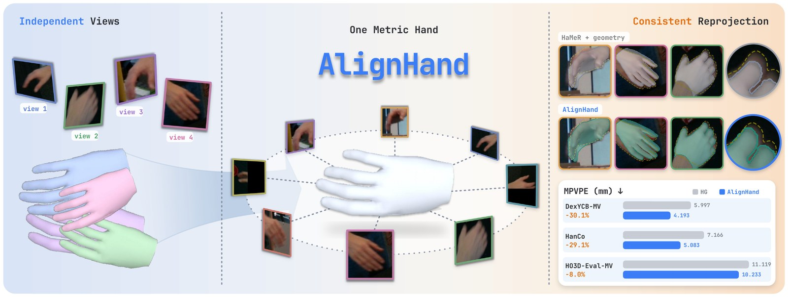
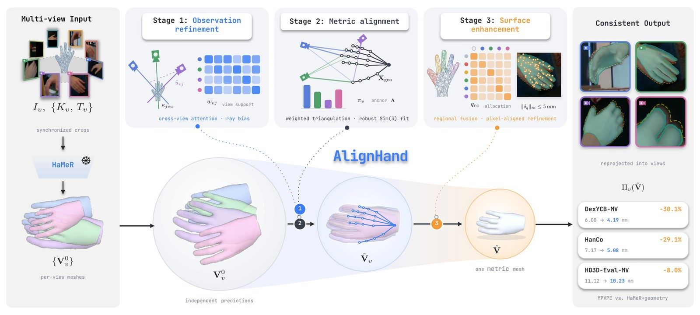
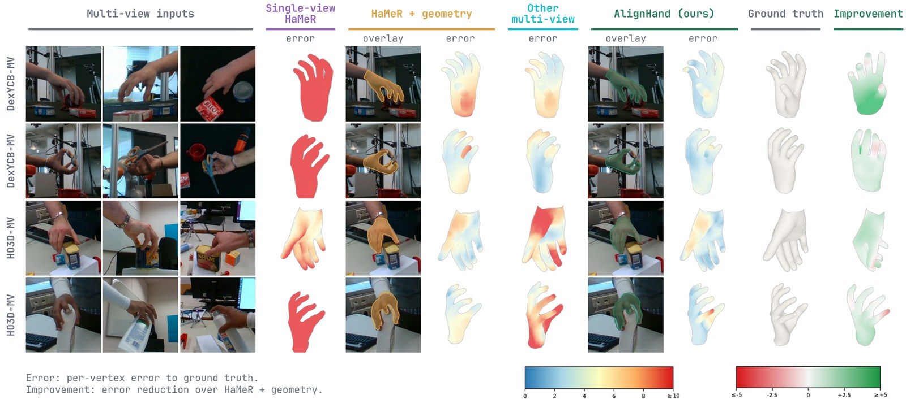

# AlignHand: Multi-View Hand Reconstruction from a Frozen Monocular Prior

> **AlignHand: Multi-View Hand Reconstruction from a Frozen Monocular Prior**
>
> Zhilu Yang, Kun Yang, Shiyan Wang, Anqi Xu, Xinran Huang, Yizheng Jiao, Huan Yang,
> [Rolandos Alexandros Potamias](https://rolpotamias.github.io/)
>
> [Project Page](https://ada-zy2425.github.io/AlignHand/) · [Paper](https://ada-zy2425.github.io/AlignHand/static/AlignHand.pdf)

<p align="center">
  
</p>

## 🗺️ Overview

AlignHand keeps a monocular hand estimator (HaMeR) frozen and turns its independent
per-view predictions into one metric hand. It refines the cross-view joint
observations, aligns every per-view mesh to a shared metric skeleton, then fuses the
aligned meshes region by region and adds a bounded pixel-aligned correction. One shared
model with 0.98M trainable parameters is used for all datasets.

<p align="center">
  
</p>

| MPVPE / MPJPE (mm) | HaMeR + geometry | AlignHand |
|---|---|---|
| DexYCB-MV | 5.997 / 5.892 | **4.193 / 4.090** |
| HanCo | 7.166 / 6.643 | **5.083 / 4.587** |
| HO3D-Eval-MV | 11.119 / 10.875 | **10.233 / 9.882** |
| HO3D-MV | 5.252 / 5.034 | **4.625 / 4.332** |

<p align="center">
  
</p>

## ⚙️ Setup

```shell
git clone https://github.com/ada-zy2425/AlignHand.git && cd AlignHand
pip install -e ".[data]"
pip install chumpy==0.70 --no-build-isolation
```

Results were produced with Python 3.10, PyTorch 2.7.1 and NumPy 1.26
(`configs/requirements-lock.txt`). Accept the licences of [HaMeR](https://github.com/geopavlakos/hamer)
and [MANO](https://mano.is.tue.mpg.de/), clone HaMeR with its checkpoint into
`third_party/hamer`, and put `MANO_RIGHT.pkl` both where HaMeR expects it and in `data/`.

## 📦 Trained Models

The model is 7.9 MB in total. Download it into `data/` and verify it with

```shell
python scripts/download_weights.py
```

## 💾 Data

Download [DexYCB](https://dex-ycb.github.io/), [HanCo](https://lmb.informatik.uni-freiburg.de/projects/contrastive_hands/)
and [HO3D v3](https://github.com/shreyashampali/ho3d) from their official pages. The
prepared views and frozen-HaMeR caches are built with the tools in `src/mvhand/cli/`;
the sample IDs of every split are in `configs/splits.zip`.

## 🌳 Folder structure

```
├── configs
│   ├── hamer_prior.example.json   paths of the HaMeR checkpoint and MANO for the demo
│   ├── weights.json               the five released model files and their sha256
│   ├── splits.zip                 sample IDs of every training / development / test split
│   └── requirements-lock.txt      exact package versions used for the paper
├── scripts
│   ├── demo/infer.py              run AlignHand on one multi-view group
│   ├── eval/test_*.py             Table 1 on DexYCB-MV, HanCo, HO3D-Eval-MV, HO3D-MV
│   ├── eval/dev_analysis.py       Table 2: error after each stage (development sets)
│   ├── train/                     Stage I, then regional fusion and refinement
│   ├── lib/                       pipeline, refinement, metrics, HanCo data access
│   └── download_weights.py
├── src/mvhand
│   ├── prior/                     frozen HaMeR: loading, feature caching
│   ├── observation/               Stage I: 2D joint correction and per-view support
│   ├── geometry/                  cameras, triangulation, metric alignment of meshes
│   ├── fusion/                    regional fusion of the aligned meshes
│   ├── refinement/                pixel-aligned refinement
│   ├── pipeline/                  end-to-end forward pass
│   ├── training/                  Stage I training
│   ├── data/                      DexYCB, HanCo and HO3D readers
│   ├── evaluation/                protocol and metrics
│   └── cli/                       build splits and frozen-HaMeR caches
├── media                          figures of this README
├── third_party                    (not tracked) HaMeR
└── data                           (not tracked) datasets, caches, MANO, weights
```

The released model is called `u2` in the code and outputs: `u2_A` is the aligned anchor,
`u2_X_R` adds regional fusion and `u2_Full` is the final AlignHand result; `HG` is the
HaMeR + geometry baseline.

## 🚀 Running AlignHand

Run on one multi-view group (images, intrinsics, camera poses and hand boxes in `group.json`):

```shell
python scripts/demo/make_mano_assets.py --mano data/MANO_RIGHT.pkl --out data/handoff/models/assets
python scripts/demo/infer.py --spec group.json --hamer-config configs/hamer_prior.example.json \
  --stage1 data/results/u2/stage1_s20261023/CHECKPOINT_UPDATE_16800.pt \
  --r data/results/u2/r_s20261023/R_FINAL.pt --ref data/results/u2/ref_s20261023/REF_FINAL.pt \
  --stats data/results/u2/U2_GEOMETRY_STATS.pt \
  --region-basis data/handoff/models/assets/region_mask_b_778x6.npy \
  --mano data/MANO_RIGHT.pkl --out outputs/
```

Reproduce the paper:

```shell
python scripts/eval/test_dexycb.py                     # Table 1; also test_hanco.py run, test_ho3d_eval_mv.py, test_ho3d_mv.py
python scripts/eval/dev_analysis.py --dataset dexycb   # Table 2, stage by stage
bash scripts/train/run_all.sh                          # training
```

A fresh install with only the released model reproduces every number in Table 1 to
within 0.0005 mm (Table 1 uses the fields `abs_v` / `abs_j21`, and `ust_mpvpe_root` /
`ust_mpjpe_root` for HanCo).

## 🙏 Acknowledgements

We thank the authors of [HaMeR](https://github.com/geopavlakos/hamer), [MANO](https://mano.is.tue.mpg.de/),
[DexYCB](https://dex-ycb.github.io/), [HanCo](https://lmb.informatik.uni-freiburg.de/projects/contrastive_hands/)
and [HO3D](https://github.com/shreyashampali/ho3d).

## 📜 Citation

```
@misc{yang2026alignhand,
  title  = {AlignHand: Multi-View Hand Reconstruction from a Frozen Monocular Prior},
  author = {Yang, Zhilu and Yang, Kun and Wang, Shiyan and Xu, Anqi and Huang, Xinran
            and Jiao, Yizheng and Yang, Huan and Potamias, Rolandos Alexandros},
  year   = {2026}
}
```

## 👩‍⚖️ License

Code is released under the [MIT License](LICENSE). HaMeR, MANO and the datasets are subject to their own licences.
